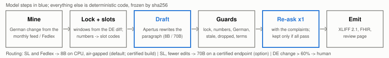
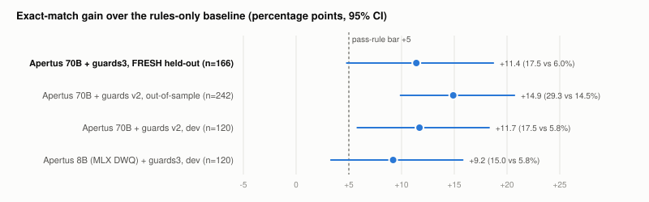

# Technical report: Gleichlaut

Keeping the French and Italian of Switzerland's drug-reimbursement conditions in step with the German, with Apertus.
Numbers never reach the model; frozen deterministic checks decide what is ready.

- **Track:** Track 2B: Gleichlaut
- **Event:** Online
- **Team:** 444
- **Review register (live):** https://mi11ione.github.io/gleichlaut/
- **Declared maturity:** feasibility study

## 1. Summary

**The job.** BAG maintains the 1,688 reimbursement conditions ("limitations") of the Spezialitätenliste in German,
French and Italian under one identifier, as three text fields in its ePL editor, published monthly for the 9.08 million
people in basic insurance (22.6% of residents name French and 7.8% Italian as a main language). In 7.5 months of 2026,
216 German texts changed (28.7 a month); BAG updated French and Italian in the same month for 208 of them. BAG's own
review asks applicants to declare that "die Übersetzungen sind kongruent". Where they are not, the difference we find is a number: in
the 6 Oct 2026 register, 10 limitations carry 5 independent divergences (Nemluvio every 8 weeks vs "ogni 4 settimane";
Diaphin 6% vs 12%; a French-only "≥ 62.5 kg" condition in three etanercept biosimilars; a 16 kg limit missing in French
for Cresemba; a 15–30 kg tier missing or shifted in French for four Dupixent limitations).

**Two tools, one rule.** *Draft*: when the German changes, Gleichlaut locks the old French/Italian outside the edit,
replaces every number with a slot code that code writes back, lets Apertus rewrite the wording, and runs a frozen stack
of deterministic checks that marks the draft ready or flagged and explains why in the reviewer's language. *Audit*:
compares the numbers of every limitation across the three languages and lists the conditions that disagree. The model
never sees a number (it wrote 0 digits in 285 calls; 3 number words it wrote were all flagged) and never judges anything.

**Results.** On a pre-registered held-out set of 166 French/Italian amendments from SL changes between Jun 2025 and Feb 2026 (154 in edit patterns never
seen during design; checks and resources hashed before any output existed), Apertus 70B drafts equal BAG's published
text **17.5%** of the time against **6.0%** for the no-model start (old text with numbers
updated by code): **+11.4 points, 95% CI [4.8, 18.7]**; against rules+, our strongest no-model baseline, **+6.6 [1.8, 12.0]**. They cut the token edits still needed to reach BAG's text by **42.4%**
[31.0, 54.1]. **39.8%** of drafts come out ready, with **0** meaning errors, stale changes or German left among them,
and a rerun with a new seed passes the same rule (+12.0 points, 41.6% ready). **The shipped Apertus 8B, on a CPU,
passes the same pre-registered rule** (Q8_0, the default build: +11.4 points [4.8, 18.7], 37.3% ready; Q4_K_M, for an
8 GiB box: +10.8 points [4.8, 17.5], 36.1% ready; 0 meaning errors among ready drafts in both), so the default deployment
is fully air-gapped. At Q8_0 the 8B matches the 70B on identical drafts (17.5%), with
0 errors of any severe kind among its 62 ready drafts; the 70B still saves more edits (42.4% vs 33.1% for Q8_0, paired
difference 9.3 points [−1.3, 20.2]; vs 20.9% for Q4_K_M) and its ready drafts rarely need a fix to the amendment (3 of 66). The audit reduces 1,688 limitations to
**27** findings that contain **all 10** known divergent limitations, **5** new confirmed problems (typos next to
numbers) and Keytruda's Italian field holding the French text (spotted by hand before the language check existed).
On 1,000 divergences planted into clean limitations its recall is 77.2% [74.5, 79.7]: 93.0% for a changed number,
94.0% for a field in the wrong language, 51.0% for a typo next to a number. A draft costs **CHF 0.0024** at a Swiss provider's
published price for Apertus 70B. `make run` re-executes the recorded runs offline and re-derives every number.

## 2. Architecture



| Module (`src/gleichlaut/`) | Role |
|---|---|
| `frozen/` | the research code, byte-identical and hash-checked: lock, slots, rules, prompt, drafting loop, checks, re-ask, scorer |
| `core.py` | executes the frozen definitions via `ast` with an injected model backend (no re-implementation) |
| `audit.py` | numeric congruence of DE/FR/IT across the register; `audit_item` for single drafts |
| `backends.py`, `certify.py` | `openai` (any `LLM_BASE_URL`, served model checked), `llamacpp` (CPU GGUF, digit mask), `cache` (hash-addressed replay); endpoint-bound certification and drift canary |
| `sl/`, `fed/`, `cli.py month` | ingest the monthly feed or Fedlex versions, mine German changes, draft, resume |
| `emit/`, `ui/` | XLIFF 1.2 and 2.1 (validated against the OASIS XSDs), FHIR R5 (checked against the CH EPL profile), review register |
| `replay.py`, `score.py` | `make run`: verify the freeze, re-execute recorded runs, re-score, compare |

### Target architecture

On-premise and air-gapped by default. The audit, the checks, the register and the XLIFF/FHIR output are Python standard
library plus `lxml`. SL conditions and statutes are drafted by Apertus 8B (GGUF Q8_0 by default, 16 GiB RAM; Q4_K_M on an 8 GiB box) on CPU
in process. Offices that
want fewer edits add Apertus 70B on an endpoint they control: own GPUs (bf16 144.6 GB) or a Swiss provider
(Infomaniak, Swisscom, PHOENIQS, Safe Swiss Cloud and OnPrem.ai serve it from Switzerland; Infomaniak CHF 0.70 / 2.50
per million input/output tokens). No provider-specific code exists: an endpoint is admitted only by a certificate bound
to its address and served model, earned by re-running the frozen 166-item suite (`make certify`); a canary detects drift.

| Lane | Model, where | External services at runtime | Data sent |
|---|---|---|---|
| Audit, checks, register, XLIFF/FHIR | none | none | none |
| Federal statutes | Apertus 8B GGUF, CPU, in process; drafts go to review | none | none |
| SL conditions, default | Apertus 8B GGUF, CPU, in process (passes the pre-registered rule) | none | none |
| SL conditions, fewer edits | Apertus 70B on a certified, user-controlled endpoint | that endpoint only | one limitation text (DE old/new, FR or IT), numbers as slot codes; before publication this is BAG's confidential draft, hence an endpoint BAG controls |

Build time only: Docker base image (pinned by digest), PyPI, the sha256-pinned GGUF. Runtime dependencies and licences
(Apache-2.0 weights under the Apertus AUP): `docs/dependencies.md`, `docs/target-architecture.md`. Public AI served the
evaluation only.

## 3. Use of Apertus

### 3.1 Models and builds

| Use | Model / build | Where it ran for the reported numbers |
|---|---|---|
| SL drafting | Apertus v1.5 70B | Public AI through a budget gateway; temperature 0; plain user messages; served model logged |
| SL and statute drafting (default) | Apertus v1.5 8B GGUF Q8_0, sha256-pinned | 4-core CPU GitHub runners via llama.cpp (R1/M2, 200.5 s per draft); greedy; digit and number-word logit mask |
| SL and statute drafting (8 GiB option) | Apertus v1.5 8B GGUF Q4_K_M, sha256-pinned | the same runners and decoding (R1/M1, 153.4 s per draft) |
| research arms (dev, statutes) | Apertus v1.5 8B, MLX 4-bit DWQ | a laptop; this build agreed with bf16 on 548 of 648 decisions in our parity battery, the GGUF on 622 |

We do not control which weights Public AI serves. The 70B name is answered by two backends (`tp2` and `fp1-nes`,
logged per call where the API reports it: 202 / 81 calls in the seeded rerun); `fp1-nes` also answers the
`apertus-v1.5-8b` name with byte-identical greedy outputs in 760 of 792 cells. We infer that it serves the 70B from MMLU
(84.4% on 250 questions, against 70.8% for the v1 8B route), which is evidence, not proof. So every 8B number here comes
from local runs, and the 70B rows describe "the 70B as Public AI served it"; the 8B rows carry a digit and number-word
logit mask that the API cannot offer the 70B (the 70B's 3 number-word drafts were all flagged).

### 3.2 How the model is used, and which size

One prompt (Appendix A): old and new German, a code-derived list of the German changes, and the old French/Italian
text, numbers as slot codes; the model returns the amended paragraph. The 70B wrote 0 digits in 285 calls; in 3 of 166
drafts it wrote a number word itself ("due", "quatre", "quattro"), and all 3 were flagged; the 8B cannot emit either.
**Size is measured on the same items in both directions.** SL conditions (pre-registered R1, same pipeline, same 166
items): both 8B GGUF builds pass the rule (Q4_K_M: flagged 63.9%, ready drafts 0 meaning errors and 3 stale or German;
Q8_0: flagged 62.7%, ready drafts 0 / 0 / 0), so under R1 the SL default is the local 8B. Quantisation matters as much
as size: Q8_0 ties the 70B on exact match and is within the paired CI on edits saved (33.1% vs 42.4%, difference
[−1.3, 20.2]); Q4_K_M is clearly behind on edits (20.9%, difference [8.7, 34.9]). The 70B is worth its endpoint where
editing time matters (ready drafts needing a fix: 3 of 66, against 25 of 62 for Q8_0 and 33 of 60 for Q4_K_M, mostly one
insurance term). The research-phase MLX build had flagged 85.0% on dev
items without the re-ask. Federal statutes (pre-registered R5, 120 paragraphs): the 70B is no better (exact
48.3% vs 50.0% for the 8B MLX build; 2 vs 0 real errors among drafts marked ready). The shipped GGUF builds on the same
items (R6) reach 45.8% (Q4_K_M) and 47.5% (Q8_0) but mark 4 drafts ready that change a provision, so no size passes the
rule there; statutes use the 8B on CPU, and their drafts go to
review because German job titles ("EFZ") need a terminology list that only exists for the SL so far.

### 3.3 Where Apertus fell short, and what does that job instead

| Task | Result | Done instead by |
|---|---|---|
| Free translation of the new German (8B MLX 4-bit, dev 120) | 0% exact; lexicon counters fire on 78 of 120; a seeded read of 20 found 2 real flips ("deve" → "dovrebbe"), about 8 in 120, none flagged | locked rewrite of the old text |
| Edit only a marked span (dev 120) | span ignored in 73% (8B) and 81% (70B) of windows | whole-paragraph rewrite + lock check |
| Judge DE/FR/IT equivalence (9 known Fedlex divergences) | as a yes/no answer, 8B (MLX) 0 of 9, 70B 0 of 9 ("they differ" in 2 of 270 answers); the 8B's log-probabilities rank the divergent language first in 6 of 9 (AUROC 0.81, order-fragile), which the API does not expose for the 70B | deterministic checks and the audit |
| Type numeric conditions | 8B operator accuracy 36%; errors correlated across languages | code (slots, audit) |
| SL drafting with the 8B, MLX build, no re-ask (dev 120) | flagged 85.0%; 1 ready draft reverses a meaning | the shipped GGUF build with the full pipeline (passes R1) |
| SL terminology with the 8B GGUF (held-out 166) | 29 of 60 ready drafts use "assurance obligatoire de maladie" for BAG's "…des soins" | the 70B, or a terminology list |
| SL drafting, 70B with the earlier checks (out-of-sample 242) | failed the rule: 4.1% of items with German left, unflagged | copied-from-German, terminology and vocabulary checks, then a new held-out set |
| Self-correction | 8B greedy retry fixed 0 of 26; 70B re-ask fixed 3 of 98 | one re-ask, kept only if every check passes |

## 4. Data

| Source | Use | Licence |
|---|---|---|
| BAG ePL FHIR R5 feed, 9 usable 2026 snapshots | 2026 change pool (dev 120, out-of-sample 242), backtest, audit (6 Oct) | official publication |
| SL XMLPublications Jun and Jul 2025 (Wayback captures) | the held-out set (166); check resources (Jun 2025 only) | official publication |
| Fedlex consolidated versions (SPARQL + AKN XML) | statute lane (120 FR/IT paragraphs, 26 acts) | not protected (URG Art. 5) |

A change counts if at most 60% of its tokens changed (27 larger rewrites in the window go to a translator). The ePL
export dropped every `<…>` span in the Feb–Apr and 4 May 2026 snapshots; May is excluded and affected pairs are dropped.
No personal data.

## 5. Evaluation

Exact = equal to BAG's published text after whitespace/apostrophe normalisation. CIs: paired cluster bootstrap over
German changes. Every ready non-exact draft was read in full; a seeded 20 flagged drafts estimate review load. Pass rule
(pre-registered): unflagged real errors ≤ 1%, unflagged stale + untranslated ≤ 2%, exact ≥ rules + 5, flagged ≤ 70%.

| Setup (FR+IT) | Set | n | Exact | Δ vs rules [95% CI] | Flagged | Ready | Ready with real / stale / untranslated | Rule |
|---|---|---|---|---|---|---|---|---|
| Rules only (old text + numbers) | held-out | 166 | 6.0% | | | | | |
| rules+ (also copies names, deletes sentences) | held-out | 166 | 10.8% | | | | | |
| **Apertus 70B + checks + re-ask** | **held-out** | **166** | **17.5%** | **+11.4 [4.8, 18.7]** | **60.2%** | **39.8%** | **0 / 0 / 0** | **PASS** |
| same, unseen edit patterns | held-out | 154 | 15.6% | +12.3 [5.8, 20.1] | 60.4% | 39.6% | 0 / 0 / 0 | PASS |
| same, rerun with seed 1 (R2) | held-out | 166 | 18.1% | +12.0 [5.4, 19.3] | 58.4% | 41.6% | 0 / 0 / 2 | PASS |
| Apertus 70B, earlier checks | out-of-sample | 242 | 29.3% | +14.9 [9.9, 20.7] | 61.6% | 38.4% | 1 / 0 / 10 | FAIL |
| **Apertus 8B GGUF Q8_0 on CPU + checks + re-ask (R1, M2; default)** | **held-out** | **166** | **17.5%** | **+11.4 [4.8, 18.7]** | **62.7%** | **37.3%** | **0 / 0 / 0** | **PASS** |
| **Apertus 8B GGUF Q4_K_M on CPU, same (R1, M1; 8 GiB option)** | **held-out** | **166** | **16.9%** | **+10.8 [4.8, 17.5]** | **63.9%** | **36.1%** | **0 / 1 / 2** | **PASS** |
| Apertus 8B (MLX DWQ), no re-ask | dev | 120 | 15.0% | +9.2 [3.3, 15.8] | 85.0% | 15.0% | 1 / 0 / 0 | FAIL |
| Statutes: 8B (MLX DWQ) | Fedlex (dev) | 120 | 50.0% | rules 35.0% | 31.7% | 68.3% | 0 / 4 / 4 | review all |
| Statutes: 70B | Fedlex (dev) | 120 | 48.3% | rules 35.0% | 23.3% | 76.7% | 2 / 1 / 4 | review all |
| Statutes: 8B GGUF Q4_K_M (R6) | Fedlex (dev) | 120 | 45.8% | rules 35.0% | 28.3% | 71.7% | 4 / 4 / 6 | review all |
| Statutes: 8B GGUF Q8_0 (R6) | Fedlex (dev) | 120 | 47.5% | rules 35.0% | 26.7% | 73.3% | 4 / 3 / 6 | review all |



**Reviewer effort.** Starting from the draft instead of the old text with updated numbers, a translator makes 42.4%
fewer token edits to reach BAG's published text (95% CI [31.0, 54.1]); 59.1% fewer on ready drafts; fewer on 114 of
166 items, more on 29. Of a seeded 20 flagged drafts, 13 needed no change: the checks are tuned to miss nothing.

**Stability.** The seeded rerun reproduced 69.9% of final outputs byte-for-byte and the ready/flagged verdict with
κ 0.963. Outputs at temperature 0 differ between calls, possibly because requests are routed between the two serving
backends; either way, this is why certification re-runs the whole suite on the endpoint it certifies.

**Audit.** On the 6 Oct 2026 register, numeric check: 21 findings in 17 limitations; all 10 known divergent limitations
and all 13 of their known values are among them; a blind annotation finds 10 of the 21 real (47.6%, Wilson
[28.3, 67.6]); the other 11 are paraphrases such as "ab 18 Jahren" vs "adultes", or typos. Language and editorial
checks (added in round 2, rules written before any label): 6 findings, all 6 confirmed: Keytruda's Italian field holds
the French text since 1 Aug 2026, and five typos next to numbers ("de15 kg", "1 .4 mmol/l", "se mesi"). In total 16 of
27 findings are real (59.3%). Terminology learned from BAG's own corrections (round 3): 11 findings, 8 confirmed
(four French texts naming an ACE inhibitor for angiotensin-II receptor antagonists, four ungrammatical Italian ones).
On MiGeL and the Analysenliste (1 Jul 2026), lists the rules were never designed on: 11 findings, 7 confirmed (63.6%),
among them an Analysenliste position billable after 13 repetitions in Italian and 14 in German and French.

**Labels.** Every ready non-exact draft and the flagged sample were read in full by a blind annotator; a second blind
annotator re-labelled them (agreement 62 of 69, κ 0.532) and found no meaning error, stale change or German left among
the ready drafts; a third broke all 7 disagreements. Worklists and labels are in `eval/labels/`, so the labelling can be
re-run by anyone.

**Cost and scale** (recorded tokens: 285 calls; 17.15 s of model time per item, sequential):

| Volume | Items a month | Public AI (evaluation price) | Infomaniak 70B | Model time, sequential |
|---|---|---|---|---|
| 1× | 57 | $0.16 | CHF 0.14 | 0.3 h |
| 10× | 574 | $1.59 | CHF 1.36 | 2.7 h |

At this volume a per-token Swiss endpoint costs CHF 0.14 a month; dedicated 70B hardware pays only across many lists
(MiGeL and the Analysenliste carry limitation columns in the same three languages).

## 6. Design limits we measured

- **Ready means the amendment is right, not the whole text.** 18 ready French drafts keep an old drug-class
  mistranslation ("inhibiteur de l'enzyme de conversion" for angiotensin-II receptor antagonists) that BAG corrected in
  the same update; the checks compare an amendment with its German change by design, and the audit's numeric scope does
  not cover drug-class names yet.
- **Bounds counted honestly.** 0 errors in 66 ready drafts is 0 in 36 German changes and 18 edit families: 95% upper
  bounds 5.5% per draft, 9.6% per change, 17.6% per family. One boilerplate family supplies half of the ready drafts;
  without it 75.8% are flagged, which would fail the 70% flag cap of our own rule (exact gain without it: +14.4 over
  rules-only, +8.3 [2.3, 15.2] over rules+).
- **No check targets direction flips** (increase ↔ decrease); a single dropped word inside an edited window can pass.
- **The held-out gold overlaps the dev pool's inputs:** 22 of the 166 published 2025 texts reappear as old texts in
  the 2026 dev items. The vocabulary and terminology resources come from the Jun 2025 capture; the name whitelist
  (product, substance and ATC names, no limitation texts) from the feed current at design time.
- **The 5 divergences predate our window** (all present at the earliest capture, Jun/Jul 2025), so the backtest cannot
  say where they arose; the audit finds them today.

## 7. Reproducibility

`make run` (Docker, CPU, `--network none` unless `LLM_BASE_URL` is set; about 30 s on a GitHub runner) verifies the
sha256 of the frozen code, check resources and items; re-executes the recorded 70B runs end-to-end from the recorded
responses (every request rebuilt byte-for-byte and found by its payload hash: 285 of 285 for the headline run, 283 of
283 for the rerun, 242 of 242 for dev); re-scores every recorded run against `eval/results/`; drafts 5 statute
paragraphs live if `LLM_BASE_URL` is set; writes and validates XLIFF and FHIR; builds the register. `claims.tsv` maps
every number in this report to a results file; CI fails on drift. Pre-registrations: `eval/prereg/PREREG.md` (R0–R5)
with run timestamps from the gateway ledger. The first out-of-sample run failed its rule; it is reported.

**Coding assistants and labellers.** Code written with Claude Code agents (Anthropic) under the team's direction;
labels by blind Claude annotators. Apertus is the only model at runtime, and no model judges outputs.

## 8. Integration and next steps

BAG writes limitation texts itself (KVV Art. 73) in an ePL editor with one field per language; applicants answer the
"kongruent" declaration in the triennial review (the audit gives BAG its own check of it); the federal translation tool
is STAR Transit (`docs/sl-process.md`).
Gleichlaut maps onto each: Draft proposes the FR/IT fields when the DE field changes, Audit answers the congruence
question for the whole register, and translators receive XLIFF 1.2/2.1. Shadow mode (`gleichlaut month`) runs on the
public feed every month and grades itself against BAG's publication, so a pilot with the Sektion Arzneimittelaufnahmen
and the ePL team needs no new process. The first shadow month (1 Sep → 1 Oct 2026, R7) ran on CPU runners under
`--network none`: of 41 compared items, 32 add one new standard sentence and the no-model start gets none right; the
checks flagged 82.9–92.7% of drafts, and none of the 14 drafts marked ready across the three models has an error.
Next: drug-class terms in the audit, a direction-flip check, MiGeL and the
Analysenliste, and a Swiss 70B endpoint certified with `make certify`.

## License

Report CC-BY-4.0. Code Apache-2.0.

## Appendix A: the drafting prompt (verbatim, `frozen/s2/s2b.py`)

```
A Swiss reimbursement limitation (Spezialitätenliste, BAG) was amended in German. Apply exactly the same amendment to the {L} version.
Change only the words that correspond to the German change. Copy every other word and punctuation mark of the old {L} text unchanged. Use the established {L} terminology of the Spezialitätenliste. Numbers are written as slot codes such as ⟨A⟩: copy the slot codes, never write digits or numbers in words.

German (old): {de_old}
German (new): {de_new}
Changes in German:
{changes}

{L} (old): {tgt_old}

Output only the amended {L} text, nothing else.
```

## References

Sources for every external fact: `docs/sources.md` and `docs/sl-process.md` (BFS su-d-01.08.01.01; BAG T 7.01; KVV
Art. 73; SL handbook 2025; CH EPL IG 1.0.1; OASIS XLIFF 1.2/2.1; apertus-ai.org provider list; Infomaniak price page;
Apertus AUP v1.5).
