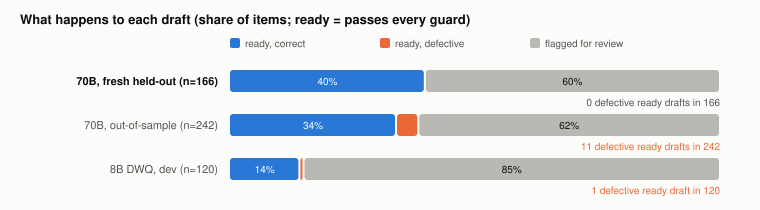

# Technical report: Gleichlaut

Guarded German→French/Italian drafting of amendments to Swiss federal texts with Apertus. Numbers reach the model only
as slot codes; frozen deterministic guards decide what is ready; nothing is published unguarded.

- **Track:** Track 2B: Gleichlaut
- **Event:** Online
- **Team:** `TEAM_NAME`: Roman `SURNAME`
- **Demo:** `VIDEO_URL`
- **Declared maturity:** feasibility study

## 1. Summary

**The problem, evidenced.** BAG publishes the conditions under which mandatory health insurance (9.08 million insured
persons, 2025) reimburses a medicine, the Spezialitätenliste (SL) "limitations", in German, French and Italian under one
identifier; 22.6% of residents name French and 7.8% Italian as a main language. BAG's own SL review checklist asks
whether "die Übersetzungen sind kongruent". In the 6 Oct 2026 feed we found **5 independent divergences in current
reimbursement conditions, and every one is a number** (verified each by reading the German, French and Italian texts side by side): Nemluvio every 8 weeks in German and French but "ogni 4
settimane" in Italian; a 6% vs 12% surcharge for Diaphin; a French-only "≥ 62.5 kg" condition in three etanercept
biosimilars; a 16 kg limit missing in French for Cresemba; a shifted 15–30 kg tier for Dupixent in French. German
limitation texts change about 28.7 times a month (216 in 7.5 months), and each change must be made again in French and
Italian without touching anything else.

**Design.** Gleichlaut drafts that change. The old French/Italian text is the starting point and stays locked outside
edit windows projected from the German diff. Numbers are replaced by slot codes before the model sees the texts, and
code writes them back. Apertus rewrites the wording of the paragraph. A frozen stack of deterministic guards (lock,
numbers/negation/modality, German left in, change not applied, content dropped, duplication, copied-from-German,
terminology, vocabulary) marks each draft **ready** or **flagged** with reasons, and translators receive the queue as
XLIFF 2.1 and as FHIR in the shape of BAG's feed. No model judges anything.

**Headline (pre-registered, held out).** On a fresh set of 166 FR/IT items mined from 2025 SL changes (154 in edit
families never seen during design), with the guards and all their resources hashed **before any output existed**:
Apertus 70B drafts equal the official text **17.5%** of the time vs **6.0%** for the no-model baseline (**+11.4 points,
95% CI [4.8, 18.7]**); **39.8%** of items come out ready, and **0 of 166** ready drafts carry a meaning error, a stale
change or untranslated German (95% upper bound 2.3% of items, 5.5% of ready drafts); a blind second Claude annotator agrees (0 severe defects among the 49
ready non-exact drafts). The pre-registered pass rule is met. «TBD:M3 one sentence on the seed-1 rerun». Cost:
**CHF 0.0024** per item at a Swiss provider's published price. `make run` re-executes this run offline from the recorded
responses and re-derives every number from them.

**Where Apertus fell short, and what did not hold** (§3.3, §6): free translation flips obligations; neither size obeys
"edit only this span"; neither can judge equivalence; the 8B flags 85.0% of SL drafts; our first out-of-sample 70B run
**failed** the pass rule; on federal statutes the 8B leaves German or a stale part in 6.7% of ready drafts, above our own
2% limit, and the 70B does no better there (2 real errors among its ready drafts); and our backtest found **no translation lag** for BAG to close: French and Italian
changed in the same monthly step as the German for 208 of 216 changes. The value is review effort and safety inside each
amendment, not speed.

## 2. Architecture


| Module (`src/gleichlaut/`) | Role |
|---|---|
| `frozen/` | the research code, byte-identical, hash-checked: lock, slots, rules, prompt, drafting loop, guards, re-ask, scorer |
| `core.py` | executes the frozen definitions via `ast` with an injected model backend (no re-implementation) |
| `backends.py` | `openai` (any `LLM_BASE_URL`, served model checked), `llamacpp` (CPU GGUF, digit mask), `cache` (hash-addressed replay) |
| `certify.py` | re-runs the frozen 166-item suite on an endpoint; the SL lane refuses an uncertified endpoint; 5-item canary |
| `sl/`, `fed/` | ingest and mine SL snapshots and Fedlex versions into change items; the Fedlex drafting lane |
| `emit/`, `ui/` | XLIFF 2.1 (validated against the OASIS XSD) and FHIR R5 (checked against the CH ePL profile); review page |
| `replay.py`, `score.py` | `make run`: verify the freeze, re-execute recorded runs, re-score, compare |

### Target architecture

On-premise for every lane; air-gapped for the lanes that run the 8B. The SL default lane needs the 70B on an endpoint
the user controls: own GPUs or a Swiss-resident provider (Swisscom, Infomaniak, PHOENIQS, Safe Swiss Cloud and OnPrem.ai
serve the 70B from Switzerland). Public AI served our evaluation and is **not** a runtime target: it routes requests
"regardless of which country's compute is serving the query".

| Lane | Model, where | External services at runtime | Data sent |
|---|---|---|---|
| Fedlex statutes (every draft reviewed) | Apertus 8B GGUF Q4_K_M, CPU, in process | none | none |
| SL default | Apertus 70B on a user-controlled endpoint, gated by `make certify` | that endpoint only | one public limitation text (DE old/new, FR or IT), numbers as slot codes |
| SL air-gapped fallback | Apertus 8B GGUF, CPU; every draft goes to review | none | none |

Runtime dependencies: Python standard library, `lxml`; for the offline lane `llama-cpp-python` and the sha256-pinned
GGUF (Apache-2.0 weights under the Apertus AUP). Build time only: Docker base image, PyPI, the GGUF download. No personal
data is processed. `docs/target-architecture.md`, `docs/dependencies.md`.

## 3. Use of Apertus

### 3.1 Models, builds, where they ran

| Use | Model / build | Where it ran for the reported numbers |
|---|---|---|
| SL drafting (default lane) | Apertus v1.5 70B | Public AI through a budget gateway; temperature 0; plain user messages |
| SL 8B arm; Fedlex drafting | Apertus v1.5 8B, MLX 4-bit DWQ | a laptop (Apple M2); greedy; digit and number-word logit mask (SL) |
| What ships for the 8B | Apertus v1.5 8B GGUF Q4_K_M (public build) | CPU via llama.cpp. In an earlier 648-decision battery against bf16, this GGUF agreed on 622 and the MLX 4-bit build we measured with agreed on only 548: our 8B numbers come from the weaker build |

The shipped GGUF has not yet run on these tasks; a sharded CPU workflow is ready (`.github/workflows/m1.yml`, R1).
Public AI's `apertus-v1.5-8b` name currently serves the 70B (identical greedy outputs in 760 of 792 cells, 70B-level
MMLU), so no 8B number here comes from that API. Every request we sent is a single user message, and every new call logs
and checks the served model.

### 3.2 How the model is used, and which size

One prompt (Appendix A): old and new German, a code-derived list of the German changes, and the old French/Italian text,
numbers as slot codes; the model returns the amended paragraph. The 70B wrote **0 digits** in 285 calls; in 3 of 166
drafts it wrote a number word itself ("due", "quatre", "quattro"), and all 3 were flagged. The 8B cannot emit either
(logit mask). **Size, measured on the same items:** on SL limitations the 8B flags 85.0% of drafts (cap 70%) while the
70B passes, so SL uses the 70B. On Fedlex statutes (pre-registered R5, same 120 paragraphs)
the 70B is **not** better: exact 48.3% vs 50.0% for the 8B, and among the drafts each marks ready, 2 real meaning errors
for the 70B vs 0 for the 8B. So statutes use the 8B on CPU. Neither size passes the pass rule there (German job titles
such as "EFZ" left untranslated, stale parts), so **every Fedlex draft goes to a translator**; "ready" means pre-checked.

### 3.3 Where Apertus fell short (and where we deliberately do not use it)

| Task | Result | Consequence |
|---|---|---|
| Free translation of the new German (8B, dev 120) | 0% exact; negation/modality/number changes in 78 of 120, none flagged ("deve" → "dovrebbe") | never translate from scratch |
| Edit only a marked span (dev 120) | span ignored in 73% (8B) and 81% (70B) of windows; exact 5.8% = rules | whole-paragraph rewrite + lock check |
| Judge DE/FR/IT equivalence (9 known Fedlex divergences) | 8B 0 of 9; 70B 0 of 9 ("they differ" in 2 of 270 answers) | no model judges; guards are code |
| Type numeric conditions | 8B operator accuracy 36%, errors correlated across languages | numbers handled by code |
| SL drafting, 8B + guards3 (dev 120) | flagged 85.0%; 1 ready draft reverses a meaning ("riduzione" for "Erhöhung") | 70B for SL |
| SL drafting, 70B + guards v2 (out-of-sample 242) | **FAILED**: 4.1% of items untranslated German, unflagged | guards3, then a new held-out set |
| Fedlex drafting, 8B + lock + slots + G1–G4 (120, dev) | 0 real errors among ready drafts, but 8 of 120 (6.7%) keep German ("EFZ") or a stale part | every Fedlex draft goes to review |
| Fedlex drafting, 70B, same lane and items | 2 real errors (1.7%) and 6 German/stale (5.0%) among ready drafts; exact 48.3% | the larger model buys nothing here: 8B |
| Self-correction | 8B greedy retry fixed 0 of 26; 70B re-ask fixed 3 of 98 | kept only because it is cheap |

## 4. Data

| Source | Use | Licence |
|---|---|---|
| BAG ePL FHIR R5 feed, 9 usable 2026 snapshots | 2026 change pool (dev 120, out-of-sample 242), backtest | official publication; no explicit reuse licence found |
| SL XMLPublications Jun and Jul 2025 (Wayback captures) | the fresh test set (166); guard resources (Jun 2025 only) | same |
| Fedlex consolidated versions (SPARQL + AKN XML) | Fedlex lane (120 FR/IT paragraphs, 26 acts) | official texts, not protected (URG Art. 5) |

A change counts if at most 60% of its tokens changed (27 larger rewrites in the window go to a human). The ePL export
dropped every `<…>` span in the Feb–Apr and 4 May 2026 snapshots; May is excluded and affected pairs are dropped. The
research crawl of Fedlex used a host path that robots.txt disallows; the shipped code uses the permitted host. No personal
data.

## 5. Evaluation

Exact = equal to the official new text after whitespace/apostrophe normalisation. CIs: paired cluster bootstrap over
German changes. Every ready non-exact draft was read in full; a seeded 20 flagged drafts estimate wasted review. Pass rule
(pre-registered): unflagged real errors ≤ 1%, unflagged stale + untranslated ≤ 2%, exact ≥ rules + 5, flagged ≤ 70%.

| Setup (FR+IT) | Set | n | Exact | Δ vs rules [95% CI] | Flagged | Ready | Ready with real / stale / untranslated | Pass rule |
|---|---|---|---|---|---|---|---|---|
| Rules only (copy + number substitution) | fresh | 166 | 6.0% | | | | | |
| **Apertus 70B + guards3 + re-ask** | **fresh, held out** | **166** | **17.5%** | **+11.4 [4.8, 18.7]** | **60.2%** | **39.8%** | **0 / 0 / 0** | **PASS** |
| same, unseen families | fresh | 154 | 15.6% | +12.3 [5.8, 20.1] | 60.4% | 39.6% | 0 / 0 / 0 | PASS |
| same, without the largest boilerplate family | fresh | 132 | 22.0% | +14.4 [6.8, 22.7] | 75.8% | 24.2% | 0 / 0 / 0 | FAIL (flags) |
| «TBD:M3 row» | | | | | | | | |
| Apertus 70B + guards v2 + re-ask | out-of-sample | 242 | 29.3% | +14.9 [9.9, 20.7] | 61.6% | 38.4% | 1 / 0 / 10 | **FAIL** |
| Apertus 8B (MLX DWQ) + guards3, no re-ask | dev | 120 | 15.0% | +9.2 [3.3, 15.8] | 85.0% | 15.0% | 1 / 0 / 0 | FAIL (flags) |
| Fedlex: 8B + lock + slots + G1–G4 | Fedlex (dev) | 120 | 50.0% | rules 35.0% | 31.7% | 68.3% | 0 / 4 / 4 | FAIL |
| Fedlex: 70B, same lane | Fedlex (dev) | 120 | 48.3% | rules 35.0% | 23.3% | 76.7% | 2 / 1 / 5 | FAIL |




**Labels.** A blind second Claude agent re-labelled the 69-draft fresh sample (49 ready non-exact + 20 flagged): agreement
on "needs a fix" 62 of 69, Cohen's κ 0.532; it found no meaning error, stale change or untranslated German among the ready
drafts. **Review effort:** 13 of 20 sampled flagged drafts needed no change (Wilson [43.3, 81.9]). **Backtest** (R3):
216 German changes; French changed in the same step 212 times, Italian 208, neither later; all 10 divergent limitations
were already divergent at the earliest capture (Jun/Jul 2025), so we cannot show where they arose.

**Cost and scale** (recorded tokens of the fresh run; 285 calls, 17.15 s of model time per item, sequential):

| Volume | FR/IT items a month | Public AI (evaluation price) | Infomaniak 70B (CHF 0.70 / 2.50 per M tokens) | Model time, sequential |
|---|---|---|---|---|
| 1× | 57 | $0.16 | CHF 0.14 | 0.3 h |
| 10× | 574 | $1.59 | CHF 1.36 | 2.7 h |

Compute is negligible. Self-hosting a 70B (bf16 144.6 GB) for this volume would not pay; a per-token Swiss endpoint or the 8B
on CPU does. The binding cost is review: 60% of drafts are flagged. Translator minutes saved have **not** been measured.

## 6. Limitations

- **0 of 166 is a point estimate**; the 95% upper bound is 2.3%. The exact gain's CI lower bound (4.8) is just under +5.
- **No direction-flip guard**; a single dropped word inside an edited window can pass.
- **One boilerplate family** carries half of the ready drafts; without it 75.8% are flagged.
- **Pre-existing divergences are carried forward:** guards check that an amendment mirrors the German change, not that the
  old French/Italian was right. A real 2026 Dupixent code change would have been drafted correctly, with its French
  weight-tier error intact.
- **SL legal status:** the equal-authority rule (PublG Art. 14) covers the official collections; we found no statute
  making SL limitations equally binding in all three languages.
- **8B SL numbers are MLX DWQ on dev items**; the shipped GGUF is unmeasured here. The 70B has not been self-hosted.
- **Labels** are by Claude agents (first and blind second annotator); the team lead's adjudication of 7 disagreements is
  pending (`eval/labels/ADJUDICATION.md`). Translator time saved is unmeasured.
- **API non-determinism:** identical requests at temperature 0 did not always return the same text (docs/provenance.md).

## 7. Reproducibility

`make run` (Docker, CPU, `--network none` unless `LLM_BASE_URL` is set) verifies the sha256 of the frozen code, guard
resources and items; re-executes the recorded 70B runs end-to-end from recorded responses (every request rebuilt
byte-for-byte and found by its payload hash: 285 of 285 for the headline run, 242 of 242 for dev); re-guards and
re-scores every recorded run against `eval/results/`; drafts 5 Fedlex paragraphs live if `LLM_BASE_URL` is set; emits and
validates XLIFF and FHIR; builds the review page. `claims.tsv` maps every number in this report to a results file; CI
fails on drift. Pre-registrations: `eval/prereg/PREREG.md` (R0–R5), committed before each run.

**Coding assistants and labellers.** Code written with Claude Code agents (Anthropic) under the team lead's direction;
hand checks by Claude Code agents, with a blind second Claude annotator. Apertus is the only model at runtime and no model
judges outputs.

## 8. Next steps

A shadow-mode pilot on BAG's monthly feed; the timed review study (translator minutes); the 8B GGUF on the fresh set
(R1); a direction-flip guard and a pre-existing-number audit; MiGeL and the Analysenliste (trilingual lists with
limitation columns); a Swiss-hosted 70B certified with `make certify`.

## License

Report CC-BY-4.0. Code Apache-2.0.

## Appendix A: the drafting prompt (verbatim, `frozen/s2/s2b.py`)

```
A Swiss reimbursement limitation (Spezialitätenliste, BAG) was amended in German. Apply exactly the same amendment to the {L} version.
Change only the words that correspond to the German change. Copy every other word and punctuation mark of the old {L} text unchanged. Use the established {L} terminology of the Spezialitätenliste. Numbers are written as slot codes such as ⟨A⟩: copy the slot codes, never write digits or numbers in words.

German (old): {de_old}
German (new): {de_new}
Changes in German:
{changes}

{L} (old): {tgt_old}

Output only the amended {L} text, nothing else.
```

## References

Sources for every external fact: `docs/sources.md` (BFS su-d-01.08.01.01; BAG T 7.01; PublG Art. 14; CH EPL IG 1.0.1;
OASIS XLIFF 2.1; apertus-ai.org provider list; Infomaniak price page; Apertus AUP v1.5; EFD language service).
